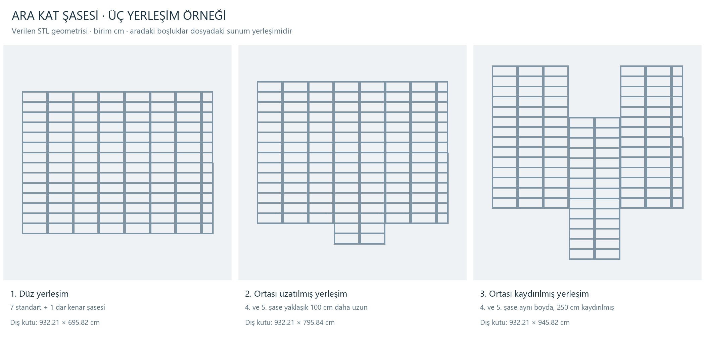

# Ara kat şasesi — alternatif montaj örnekleri

25 Ekim 2026 · DEV-149 · Geometri incelemesi; uygulama değişikliği değildir.

## Kaynak ve kapsam

Kullanıcı `C:/Users/ONUR/Desktop/arakat şasesi montaj-1.stl` dosyasını “bir alternatif olabilecek şase” olarak verdi. Kaynak değiştirilmeden `referanslar/2026-10-25-arakat/arakat-montaj-alternatif-1.stl` yoluna kopyalandı. Boyut 1.902.484 bayt, üçgen sayısı 38.048, SHA-256: `5cbd44debc34e9ae02a037935bb41f56128973b1ee4e07c0967633e1c4ac526e`.

Karşılaştırma, [önceki incelemedeki](2026-10-25-arakat-sasesi-inceleme.md) güncel 125 cm dış genişlikli `referanslar/2026-10-25-arakat/arakat.stl` ile yapıldı. Birim, bu STL serisi için kullanıcının teyit ettiği santimetredir; STL kendi başına birim belirtmez. Kesin kullanıcı kuralı: standart şase dıştan 125 cm, yükseklik 20 cm, boy projeye göre değişken, alt kat duvarlarının üstüne oturur. Duvar panelinin 125,5/62,75 cm modülüyle karıştırılmayacak.

## Dosyanın içerdiği üç düzen

Dosya, aralarında büyük sunum boşlukları bulunan üç ayrı montaj içeriyor. Bütün dosyanın yaklaşık 4.452 cm genişliğini tek binanın eni olarak kullanmak yanlış olur. Her montajda sekiz şase var: yedi standart genişlikli ve bir dar kenar şasesi.

| Düzen | Geometride görülen fark | Yaklaşık dış çevre kutusu, cm |
|---|---|---|
| 1 — Düz | Bütün şaseler aynı boyda | 932,21 × 695,82 × 20,04 |
| 2 — Ortası uzatılmış | Soldan 4. ve 5. şase yaklaşık 100 cm uzatılmış; diğerleri aynı boyda | 932,21 × 795,84 × 20,06 |
| 3 — Ortası kaydırılmış | Soldan 4. ve 5. şase aynı boyda kalıp planda 250 cm kaydırılmış | 932,21 × 945,82 × 20,04 |

Üçüncü düzende iki şasenin boyu hâlâ yaklaşık 695,82 cm; bir tarafta 250 cm girinti, diğer tarafta 250 cm çıkıntı oluşuyor. Bu düşey kat/kot farkı değildir. Modelde duvarlar bulunmadığından girintinin merdiven boşluğu, çıkıntının konsol veya belirli bir mesnet çözümü olduğu varsayılmadı.

Standart parçaların geometri dış eni yaklaşık 125,025 cm, yan yana yerleşim adımı 125 cm. Kullanıcının nominal dış ölçüsü 125 cm olarak korunur. Son kenar parçası yaklaşık 57,21 cm dış genişlikte; bu dosyaya özgü bir tamamlama parçasıdır, genel bir “yarım şase” standardı veya 62,75 cm panel kuralı değildir.

## Önceki şaseyle geometri karşılaştırması

- Birinci ve üçüncü montajdaki yedi standart şasenin tamamı önceki tek şase geometrisiyle eşleşiyor. İkinci montajdaki uzatılmayan beş standart şase de aynı. Kontrol, yalnız kutu ölçüsünü değil öteleme çıkarıldıktan sonra nokta ve üçgen eşleşmesini kullandı; karşılaştırma eşiği 0,001 cm. Bu eşik imalat toleransı değildir.
- Her şasede iki uzun yan profil ve iki başlık görülüyor. Normal boydaki şaselerde 13, uzatılmış iki şasede 15 enine kayıt var. Üç montajın bağlı geometri grubu sayıları sırasıyla 136, 140, 136; toplam 412. Bu gruplar STL ayrıştırma sonucudur, ayrı imalat ürün kimlikleri değildir.
- Enine kayıt merkezleri arasındaki ölçü bu örneklerde yaklaşık 49,269 cm. Uzayan şaselerde iki kayıt daha eklenmiş. Bu gözlemden genel 50 cm aralık veya her projede sabit kayıt adedi kuralı çıkarılmadı.
- İkinci montajın 4. şasesinde yaklaşık 0,02 cm düzeyinde küçük konum farkları var. Bunlar kaynak geometrinin ölçüm bulgusudur; yeni bir tasarım payı veya farklı şase yüksekliği tanımlamaz.
- Yan yana gelen şaselerin kendi yan profilleri ayrı kalıyor. Yerleşim modeli bunları tek profile birleştirmemeli.

## Programa aktarılacak karar taslağı

Bu dosya önceki şaseyi değiştiren yeni varsayılan olarak değil, aynı aile için alternatif yerleşim referansı olarak kaydedildi. Henüz ana uygulamaya veya bağımsız taslağa eklenmedi.

Gelecekte ara kat modelinde her şasenin ayrı kimliği, standart/özel kenar tipi, dış eni, boyu, plandaki başlangıç-bitiş konumu ve alt kat duvarlarına oturma ilişkisi olmalı. Böylece farklı boydaki parçalar aynı montajda bulunabilir; aynı boydaki parça boyu bozulmadan kaydırılabilir; sonda kalan genişlik özel kenar parçasıyla tamamlanabilir. Bütün montajı orantılı ölçeklemek bu kuralları bozar.

Plan, 3B, imalat ve metraj aynı parça listesini okumalı. Özel kenar genişliği, boy ve yer değişikliği parça listesine yansımalı. Fiyat listesi verilmeden fiyat eklenmeyecek. Görsel yerleşim ile mesnet/bağlantı uygunluğu ayrı doğrulanacak; bu STL tek başına taşıma kapasitesi veya bağlantı yeterliliği hesabı sağlamaz.

## Kontroller, açık bilgiler ve sonraki adım

Kaynak/kopya hash eşitliği, ikili STL uzunluğu ve üçgen sayısı, üç grubun toplamı, 24 şasenin ayrımı, başlık/kayıt adetleri ve 19 standart şasenin önceki örnekle tam üçgen eşleşmesi doğrulandı. Üst görünüş karşılaştırması ve izometrik görseller incelendi. Geometri dönüştürülmedi veya yeniden ölçeklenmedi.

Profil/sac üretim standardı, kayıt aralığının genel kuralı, özel kenar parçasının izin verilen enleri, uç/mesnet payları, bağlantılar ve girinti-çıkıntıların duvarlarla ilişkisi hâlâ açık. Sonraki adım: gerçek kat/kot modeline bu şase ailesini ayrı parçalar olarak bağlamak ve duvar planıyla yerleşimini doğrulamak. Bu uygulama işi tamamlandı sayılmaz.

Dosyalar: [ölçüm JSON](2026-10-25-arakat-alternatif-geometri.json), [kaynak/artifact envanteri](2026-10-25-arakat-alternatif-envanteri.json), [1. izometrik](2026-10-25-arakat-alternatif-grup-1.png), [2. izometrik](2026-10-25-arakat-alternatif-grup-2.png), [3. izometrik](2026-10-25-arakat-alternatif-grup-3.png). Tekrar üretim: `python tools/inspect-arakat-alternative.py`; Python, NumPy ve Pillow kullanır.

Plan Studio 5.9.137, `plan_cizim.html`, `src/`, `dist/`, `taslaklar/odak-atolyesi/` ve kullanıcının çizimleri değiştirilmedi. Önceki açık işler korunur.
