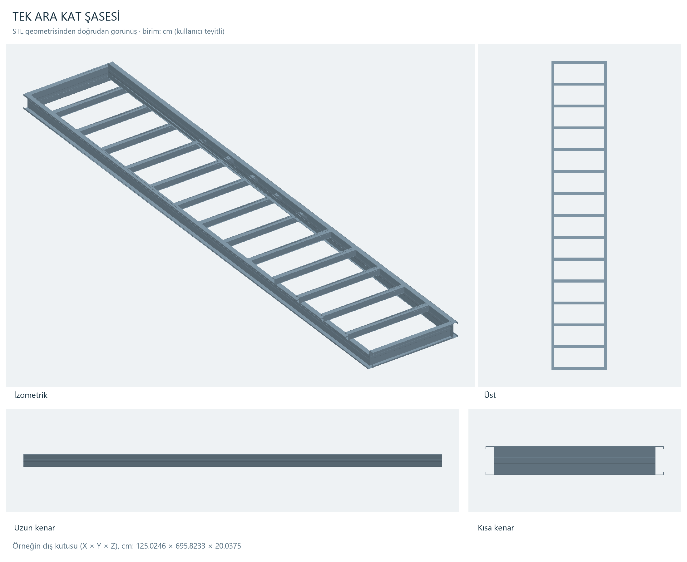
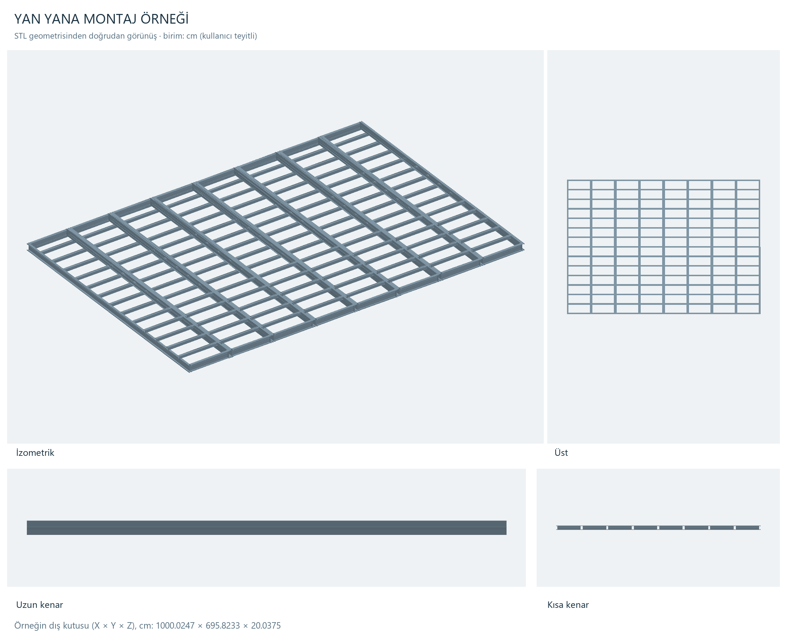
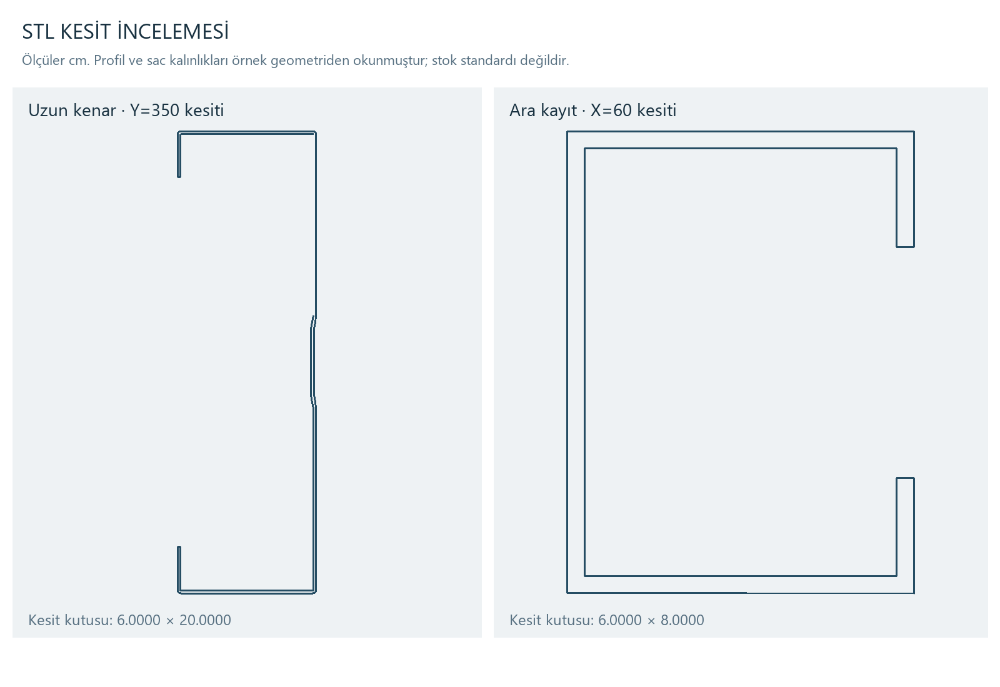

# Ara kat şasesi ve yan yana montaj örneği

25 Ekim 2026 · DEV-148 · Kullanıcının iki STL dosyasının geometri incelemesi

**Kesinleşen kullanıcı kuralı**

Ara kat şasesinin toplam **dış genişliği 125 cm**, nominal yüksekliği **20 cm**, uzunluğu ise **projenin kendi doğrultusundaki boyuna göre değişken** olacak. Ölçü birimi kullanıcı tarafından santimetre olarak teyit edildi. Kullanıcı ayrıca 125 cm'nin iç açıklık değil dış genişlik olduğunu kesinleştirdi.

Şaseler yan yana yerleştirilir ve alt kat duvarlarının üstüne oturur. Burada tarif edilen eleman katlar arasındaki döşemeyi taşıyan şasedir. Önceki arayüz taslağındaki kat yüksekliğinin yarısında gösterilen ara kat demosu bu elemanın yerleşim kuralı değildir.

**Kaynak dosyalar**

| Kullanıcının dosyası | Korunan referans kopyası | Boyut | Üçgen |
|---|---|---:|---:|
| `C:/Users/ONUR/Desktop/arakat.stl` | [Tek şase](../referanslar/2026-10-25-arakat/arakat.stl) | 78.984 bayt | 1.578 |
| `C:/Users/ONUR/Desktop/arakat şasesi montaj.stl` | [Montaj](../referanslar/2026-10-25-arakat/arakat-montaj.stl) | 631.284 bayt | 12.624 |

İkisi de SketchUp başlıklı binary STL. Kaynaklar taşınmadı veya üzerine yazılmadı. Kaynak/kopya SHA-256 eşitliği doğrulandı; değerler [envanterde](2026-10-25-arakat-kaynak-envanteri.json). STL kendi içinde birim açıklaması taşımıyor; cm kabulü kullanıcı teyidine dayanıyor.

Kullanıcı inceleme sırasında aynı dosya adlarıyla düzeltilmiş modelleri yeniden sağladı. Güncel tek şasenin dosya zamanı 22:14:11, montajın 22:14:39'dur (yerel saat). İlk 137 cm / 6 şase örnekleri `referanslar/2026-10-25-arakat/ilk-ornek/` altında ve [ilk geometri kaydı](2026-10-25-arakat-ilk-ornek-geometri.json) ile ayrıca korundu. Aşağıdaki esas inceleme son sağlanan 125 cm / 8 şase dosyalarına aittir.

**Örnekte ölçülen geometri**

Bu tablodaki ölçüler kaynak modelin ölçüsüdür; kullanıcının yukarıdaki nominal üretim kararından ayrıdır.

| Ölçüm | Tek şase | Montaj örneği |
|---|---:|---:|
| Dış kutu genişliği X | 125,0246 cm | 1000,0247 cm |
| Boy Y | 695,8233 cm | 695,8233 cm |
| Dış kutu yüksekliği Z | 20,0375 cm | 20,0375 cm |
| Şase sayısı | 1 | 8 |
| Bağlı geometri grubu | 17 | 136 |

Montajda tek şasenin sekiz kopyası X doğrultusunda **125 cm** adımla dizilmiş. Her kopyanın üçgenleri, sıralama farkları giderildiğinde tek şaseyle eşleşiyor. En büyük çift yönlü nokta farkı 0,000034 cm'den küçük; float32 aktarım hassasiyeti düzeyinde. Y/Z yönünde taşıma veya dönme yok. Bu karşılaştırma yalnız aynı dış kutuya bakılarak yapılmadı; 1.578 üçgenin tamamı her kopyada eşleştirildi.

**Son dosya 125 cm dış en kuralına göre düzeltilmiş.** Yeni enine kayıt yaklaşık 113,0111 cm, kısa başlık yaklaşık 112,9669 cm uzunluğunda. İki yandaki yaklaşık 6 cm profil kanadıyla dış en yaklaşık 125 cm oluyor. İlk dosyada kayıt yaklaşık 125 cm ve toplam dış en yaklaşık 137 cm idi; o örnek artık esas ölçü kaynağı değildir.

Parametrik üretimde toplam dış en 125 cm tutulmalı; iki yan profilin gerçek kesitleri korunarak konumları hesaplanmalı ve enine elemanlar buna göre boylandırılmalı. `125 − 6 − 6 = 113 cm` bu örneğin kaba yerleşimini açıklıyor; kesin kesim boyu bağlantı yüzleri ve uç paylarından çıkarılmalıdır. Modelin tamamını X yönünde küçültmek profil genişliğini ve sac kalınlığını da değiştireceği için uygun yöntem değildir.

Nominal adım 125 cm, sekiz şasenin toplam eni **1000 cm = 10 m**. Modelin dış kutusunda en yönünde yaklaşık 0,246 mm ve yükseklikte yaklaşık 0,375 mm fark var; bunlar STL'de ölçülen sapmalardır, onaylı imalat toleransı olarak kullanılmadı. Gerçek montaj boşluğu veya birleşim payı ayrıca tanımlanırsa yerleşim hesabına açıkça eklenmelidir. Kullanıcı henüz böyle bir pay belirtmedi.

**Şase içeriği ve kesitler**

Tek şasede geometri ve görünüş birlikte incelendiğinde iki uzun kenar, iki kısa başlık ve **13 enine ara kayıt** ayırt ediliyor. Montaj örneği toplamda 16 uzun kenar, 16 kısa başlık ve 104 ara kaydı koruyor. Komşu şaselerin kenar profilleri birleşimde iki ayrı eleman olarak duruyor; ortak çizgi gibi görünse de metrajda tek profile indirgenmemeli.

Enine kayıtların merkezleri yaklaşık 49,2687 cm aralıkla tekrarlanıyor. İlk merkez Y=52,3308 cm, son merkez Y=643,5557 cm. Bu örnekten bütün projelerde 13 kayıt veya tam 50 cm aralık olacağı sonucu çıkarılmadı. Proje boyu değişince kayıt adedi, başlangıç/bitiş payı ve izin verilen aralık için ayrıca üretim kuralı gerekir.

Doğrudan üçgen yüzeylerden alınan kesitlerde dudaklı C biçimi görülüyor:

| Bölüm | Örnekte yaklaşık yükseklik × kanat × dudak | Düz yüzeyler arasında gözlenen kalınlık |
|---|---|---|
| Uzun kenar | 20 × 6 × 2 cm | 0,12 cm, yani yaklaşık 1,2 mm |
| Enine kayıt | 8 × 6 × 2 cm | 0,30 cm, yani yaklaşık 3 mm |

Bu değerler örnek geometrisinin okumasıdır; malzeme sınıfı, ürün kodu veya onaylı profil/sac standardı değildir. Uzun kenarda gövde üzerinde sığ bir şekillendirme de görülüyor. Ara kayıtların üstü Z≈19,9217 cm, altı Z≈11,9217 cm; kayıtlar şasenin üst tarafında yer alıyor.

Yüzey grubu sayısı tek başına bir imalat parça listesi sayılmaz. Modelde 0,00001 cm koordinat birleştirme toleransıyla tek şasede 64 açık kenar ve ikiden fazla yüzün birleştiği 38 kenar bulunuyor. Bu sebeple kapalı katı hacminden kesin ağırlık hesabı yapılmadı. Kaynak, vida, bulon, mesnet plakası, malzeme sınıfı ve montaj payı bu STL'lerden kesinleştirilmedi.

**Görsel kanıtlar**

Görseller doğrudan verilen üçgen geometrisinden ortografik olarak üretildi; kesit veya görünüş için yapay zekâ ile model uydurulmadı. Kaynak geometri yeniden boyutlandırılmadı.

**Programa bağlanacak yerleşim mantığı**

Alt kat duvar üst kotu, şasenin alt oturma referansı olmalı. Kavramsal kot sırası:

`Alt kat duvar üstü → şase altı → 20 cm şase → varsa döşeme kaplama katmanları`

Örneğin alt kat duvar üst kotu +280 cm ise şase altı +280 cm, nominal şase üstü +300 cm olur. Döşeme bitiş kotu, seçilen üst katmanların kalınlığıyla ayrıca hesaplanır. Üst kat duvarının hangi yapısal yüzeye bağlanacağı ayrı montaj ayrıntısıdır; kaplama üstüne otomatik oturacağı varsayılmamalı.

Model nesnesinde en az şunlar ayrı tutulmalı: alt kat kimliği, oturduğu duvarlar/mesnetler, döşeme alan sınırı, 125 cm dış en, 20 cm yükseklik, yerleşim doğrultusu, değişken boy, kenar/ara kayıt kesitleri, kayıt yerleşim kuralı ve birleşim payları. Alt kat yüksekliği değişince bağlı şase birlikte yükselmeli; yalnız 3B çizimi değil aynı nesnenin ölçü ve metrajı güncellenmeli.

Kullanıcı uzunluğu proje boyuna bağladı. Boyun hangi dış yüz/mesnet çizgileri arasında alındığı ve uç oturma payları, gerçek bina yerleşimiyle kesinleştirilmelidir. Bu dosyalarda alt kat duvarları yok; her bir profilin hangi duvara ne kadar oturduğu dosyadan ölçülemiyor.

125 cm'lik modüller bir döşeme alanına sığdırılırken kalan kenar şeridi, merdiven/tesisat boşluğu ve kademeli planlar için ayrı çözüm gerekir. Son şaseyi veya bütün şaseleri keyfî ölçeklemek yerine izin verilen özel modül ve kenar elemanı kuralları tanımlanmalı. Üst döşeme katmanları ve alt tavan, şaseden ayrı ama ona bağlı elemanlar olmalı.

**Tamamlananlar ve açık ayrıntılar**

İlk ve son dosyalar ayrı korundu, güncel kopyalar doğrulandı, sekiz modül eşleşmesi ölçüldü, kesitler ve görünüşler üretildi. Kullanıcının dış 125 cm / yükseklik 20 cm / projeye göre boy / alt kat duvar üstüne oturma kararı kayda alındı.

Üretim modeline geçmeden netleştirilecekler: profil ve sac standardı; ara kayıt adedi/aralık kuralı; gerçek duvar oturma ve uç payları; modül birleşimleri; kenarda kalan ölçüler ve boşluk çevreleri; döşeme/tavan katmanları. Bunlar inceleme tamamlandı diye çözülmüş sayılmaz. Geometri kontrolü taşıyıcı hesap veya üretim onayı değildir.

İnceleme aracı: [inspect-arakat-stl.py](../tools/inspect-arakat-stl.py). Sayısal sonuç: [arakat-geometri.json](2026-10-25-arakat-geometri.json). Ana uygulama, mevcut arayüz taslağı ve kullanıcı çizimleri değiştirilmedi; uygulama sürümü 5.9.137 olarak korundu.
